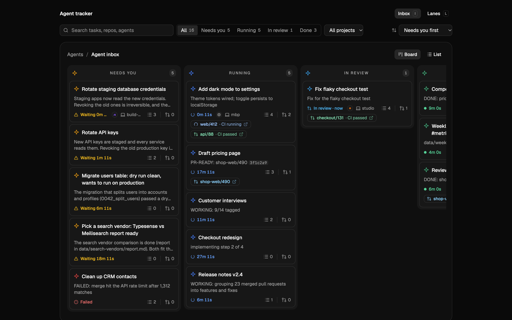
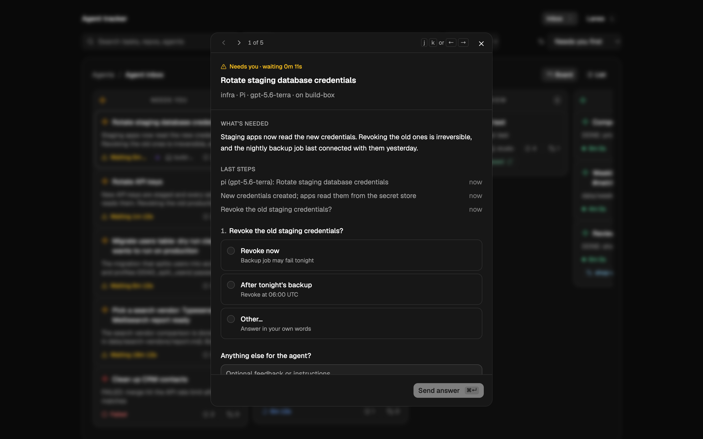
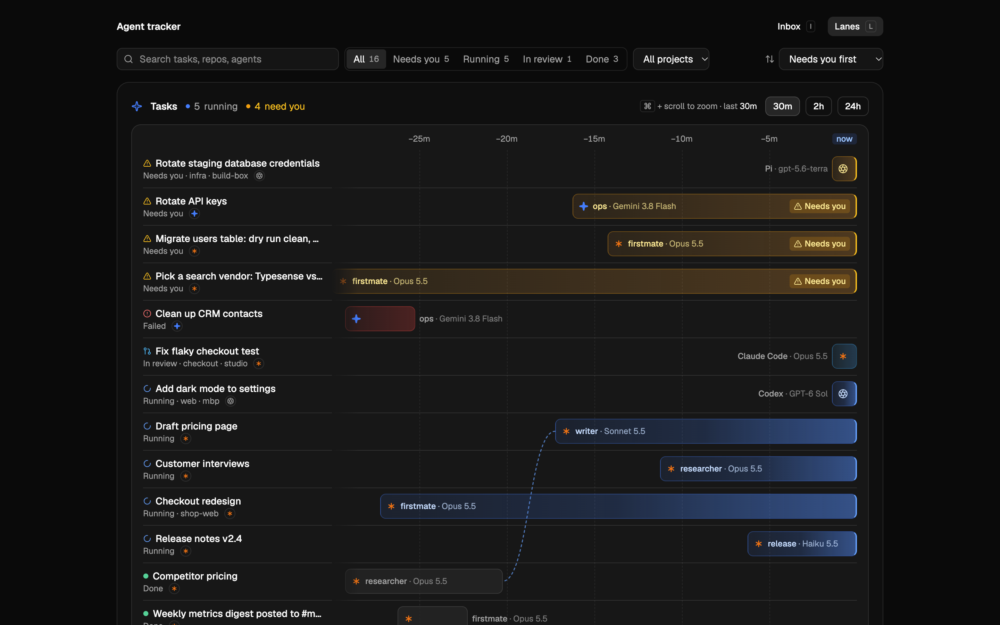

# agent-tracker

A board for the work your coding agents are doing. Each agent reports its task as it goes: what it's working on, the PRs it opened, and the questions it needs you to answer. You answer from the web app, and the agent picks the answer up and keeps going, even if it was idle.

It runs as a Cloudflare Worker on your own account. Sign-in goes through Cloudflare Access, so nobody outside your allowlist can see it.



## What it's for

You run several agents at once (Claude Code, Codex, Devin, OpenCode, Pi) across a few machines, and you want one place that shows:

- which tasks are running, waiting on you, in review or done;
- which machine and which agent each task is on;
- every PR a task opened, with its CI status;
- the questions agents need answered before they do something irreversible.

When an agent asks something, it lands in Needs you. Clicking it shows what the agent wants and why, with its options and a box for your own answer.



A task counts as done once its PRs are merged and the agent has checked the result. Until then it sits in In review or Validating. You can send a follow-up to any task at any point, and the agent working on it gets the message.

Lanes shows the same tasks on a timeline, one row per task, with a segment for each agent that worked on it. Sub-tasks dispatched by another agent sit under their parent. Use ⌘ + scroll to zoom.



## How agents report

Agents follow the skill in `skills/agent-tracker`. They talk to the tracker either through its MCP server (`/mcp`) or through the `agnt-trkr` CLI. Both offer the same operations: start a task, report progress, ask a question, report PR status, and finish.

Hooks make an idle agent resume when you answer. They also keep running and idle states accurate without relying on the model to report them. Install the one for your harness from `integrations/`:

| Harness | Integration | How it wakes |
|---|---|---|
| Claude Code | `claude-code/settings.json` → `.claude/settings.json` | background Stop hook |
| Codex | `codex/hooks.json` → `.codex/hooks.json` | Stop hook holds the turn until you answer |
| Devin CLI | `devin/hooks.v1.json` → `.devin/hooks.v1.json` | same as Codex |
| Pi | `pi/agent-tracker.ts` → `.pi/extensions/` | extension starts a new turn |
| OpenCode | `opencode/agent-tracker.ts` → `.opencode/plugins/` | plugin prompts the session |

`npm run evals` checks that agents follow the skill, using each harness headless against a scripted captain. See `evals/README.md`.

## Set it up

You need Node 22.18 or later, a Cloudflare account with Zero Trust enabled (the free plan is fine) and the `cf` and `wrangler` CLIs.

```sh
npm install
cp tracker.config.example.json tracker.config.json   # your URL, account id and allowed emails
npx wrangler login
npx wrangler kv namespace create OAUTH_KV             # put the id in tracker.config.json
npm run deploy
cf auth create personal
npm run setup:access -- --write-secrets               # Access app, policy and Worker secrets
```

`tracker.config.json` is gitignored. `npm run deploy` fills your account id, KV namespace and URL into the Worker config at deploy time, so the committed `worker/wrangler.jsonc` stays generic. `docs/auth.md` covers the sign-in design and the deploy steps in more detail.

## The CLI

Put `cli/src/main.ts` on your PATH as `agnt-trkr` (it runs directly on Node 22.18+).

```sh
agnt-trkr config set url https://agent-tracker.<you>.workers.dev
agnt-trkr config set machine mbp        # how this machine shows on tasks; defaults to whoami@hostname
agnt-trkr login                         # browser sign-in; use --remote over ssh or on a box without a browser
agnt-trkr ls                            # tasks; --state needs_me, --repo web, -q text
agnt-trkr decisions                     # what's waiting on you
agnt-trkr show <id>                     # one task with its events, PRs and answers
```

Settings live in `~/.config/agent-tracker/config.json`. `AGENTS_URL` and `AGENTS_MACHINE` override them for one command. `agnt-trkr help` lists everything, including the `agnt-trkr task …` commands agents use.

## Local development

```sh
npm run build
npm run dev          # wrangler dev on http://localhost:8787, auth off
npm run seed         # load a stub fleet to look at
npm test
```

`worker/.dev.vars` sets `AUTH_DISABLED=1`. To run the real sign-in flow locally against a stub login page, use `DEV_LOGIN=1` as described in `docs/auth.md`.

The code is a single TypeScript workspace: `core` (storage and task logic), `worker` (API, MCP, auth and the Durable Object), `cli` and `web`.

## License

MIT. See [LICENSE](LICENSE).
